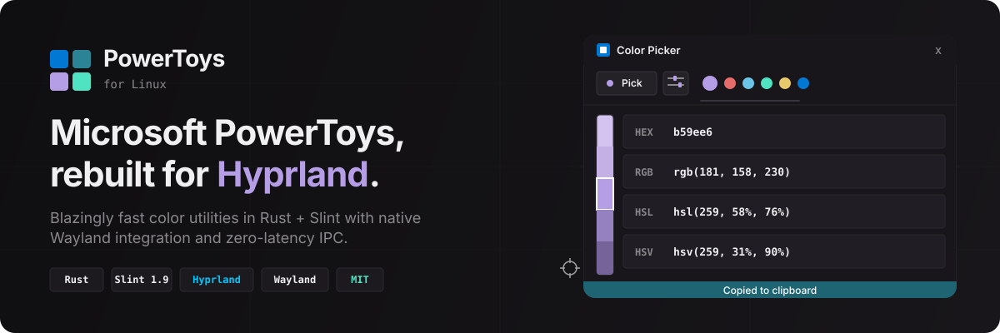
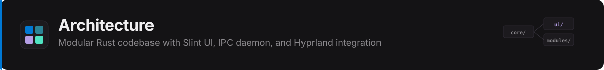

<p align="center">
  
</p>

<p align="center">
  <a href="#getting-started"><strong>Get Started</strong></a>&ensp;&middot;&ensp;
  <a href="#features"><strong>Features</strong></a>&ensp;&middot;&ensp;
  <a href="#cli--usage"><strong>CLI</strong></a>&ensp;&middot;&ensp;
  <a href="#architecture"><strong>Architecture</strong></a>&ensp;&middot;&ensp;
  <a href="#contributing"><strong>Contributing</strong></a>
</p>

---

PowerToys for Linux brings the productivity tools from Microsoft PowerToys to the Linux desktop with native Wayland ergonomics. Built in **Rust** with **Slint 1.9**, it targets **Hyprland** compositors and delivers a pixel-perfect Fluent Design interface, sub-millisecond IPC responsiveness, and zero-overhead performance.

---

## Features

<p align="center">
  
</p>

### Color Picker

A full-featured color inspection and editing utility for designers and developers.

| Capability | Detail |
| :--- | :--- |
| **Global Shortcut** | Activate instantly with <kbd>SUPER</kbd> + <kbd>SHIFT</kbd> + <kbd>C</kbd> (customizable) |
| **Native Wayland Sampling** | Uses `hyprpicker` for pixel-accurate color selection on Wayland |
| **Stepped Shades** | Generates light and dark variants of any sampled color automatically |
| **Multi-Format Conversion** | Real-time conversion across **HEX**, **RGB**, **HSL**, **HSV**, and **CMYK** |
| **HSV Color Sliders** | Fine-tune hue, saturation, and value with live gradient tracks |
| **Color Identification** | Detects and displays human-readable color names |
| **History Palette** | Stores recent picks with quick-copy swatches |
| **Clipboard Integration** | Auto-copies formatted codes via `wl-copy` with toast notifications |

### Hyprland & Wayland Native Integration

| Capability | Detail |
| :--- | :--- |
| **Dynamic Window Rounding** | Queries your active Hyprland `decoration:rounding` via `hyprctl` and applies it to the GUI |
| **Shortcut Management** | Writes keybindings to `~/.config/hypr/powertoys.conf`; supports Caelestia/Lua environments |
| **IPC Daemon** | Background Unix Domain Socket listener ensures floating windows appear with 0ms latency |
| **Floating Window Rules** | Pre-configured Wayland rules (`float`, `pin`, `center`, `noborder`) for native overlays |

### Text Extractor *(Roadmap)*

> Screen region OCR via `slurp` + `grim` + Tesseract neural engine with preprocessing pipeline for 99%+ screen accuracy, immediate clipboard copy, and formatting toggles.

---

## Getting Started

<p align="center">
  
</p>

### Requirements

<details>
<summary><strong>Arch Linux / CachyOS</strong></summary>

```bash
sudo pacman -S hyprpicker wl-clipboard libnotify slurp grim
```

Optional for Text Extractor:
```bash
sudo pacman -S tesseract tesseract-data-eng
```
</details>

<details>
<summary><strong>Fedora</strong></summary>

```bash
sudo dnf install hyprpicker wl-clipboard libnotify slurp grim
```
</details>

### Build from Source

```bash
# Install Rust toolchain (if needed)
curl --proto '=https' --tlsv1.2 -sSf https://sh.rustup.rs | sh

# Clone and build
git clone https://github.com/GopikChenth/powertoys.git
cd powertoys
cargo build --release

# Run
./target/release/powertoys
```

---

## CLI & Usage

PowerToys runs as a background daemon, a standalone GUI, or via direct CLI flags.

| Command | Action |
| :--- | :--- |
| `powertoys` | Launch the main app and start the IPC background listener |
| `powertoys --gui` | Open the settings dashboard |
| `powertoys --pick` / `-p` | Trigger the color picker immediately |
| `powertoys --popup <HEX>` | Open the color editor flyout for a specific color |

**Example:**

```bash
# Pick a color and open the editor flyout
powertoys --pick

# Open the editor for a specific hex value
powertoys --popup "#B59EE6"
```

---

## Architecture

<p align="center">
  
</p>

```
powertoys/
├── src/
│   ├── core/
│   │   ├── config.rs         # Persistent JSON config (~/.config/powertoys/config.json)
│   │   ├── hyprland.rs       # Hyprland IPC, rounding detection & keybind management
│   │   ├── ipc.rs            # Unix domain socket IPC client & listener
│   │   └── mod.rs
│   ├── modules/
│   │   ├── color_picker/     # Color picker model, shade generation & format conversions
│   │   ├── text_extractor/   # OCR text extraction module (roadmap)
│   │   └── mod.rs
│   └── main.rs               # Entry point, CLI routing & Slint event loop
├── ui/
│   └── app.slint             # Slint UI: components, layout & floating editor windows
├── build.rs                  # Slint compilation build script
└── Cargo.toml                # Dependencies: slint 1.9, serde, serde_json
```

**How it works:** The main binary starts the Slint event loop alongside a Unix domain socket IPC listener. When you press the global shortcut, Hyprland dispatches `powertoys --pick`, which either sends an IPC message to the running daemon (instant popup) or spawns a standalone picker window. The popup reads your compositor's corner radius, applies Wayland floating rules, and displays the color result with shade generation, format conversion, and clipboard integration — all in a single Rust process with zero external runtime dependencies.

---

## Contributing

Contributions, feature suggestions, and pull requests are welcome.

1. Fork the repository
2. Create your feature branch: `git checkout -b feat/my-new-feature`
3. Commit your changes: `git commit -m 'feat: add my feature'`
4. Push to the branch: `git push origin feat/my-new-feature`
5. Open a Pull Request

---

## License

This project is licensed under the [MIT License](LICENSE).
